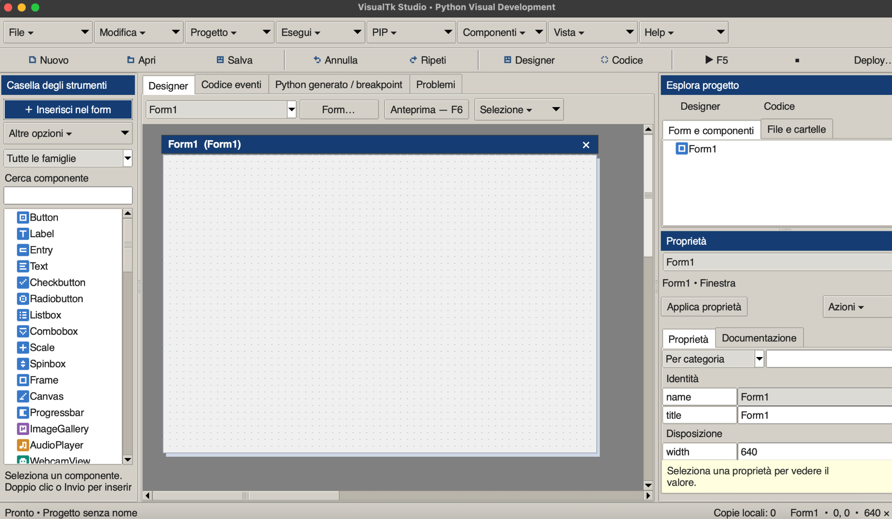
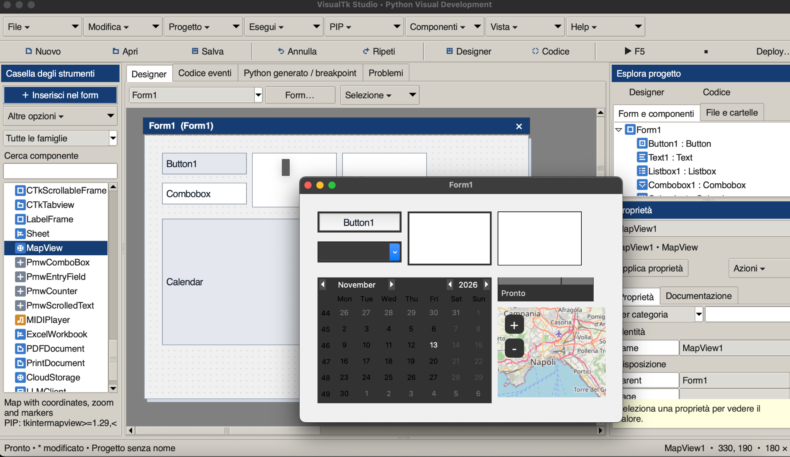
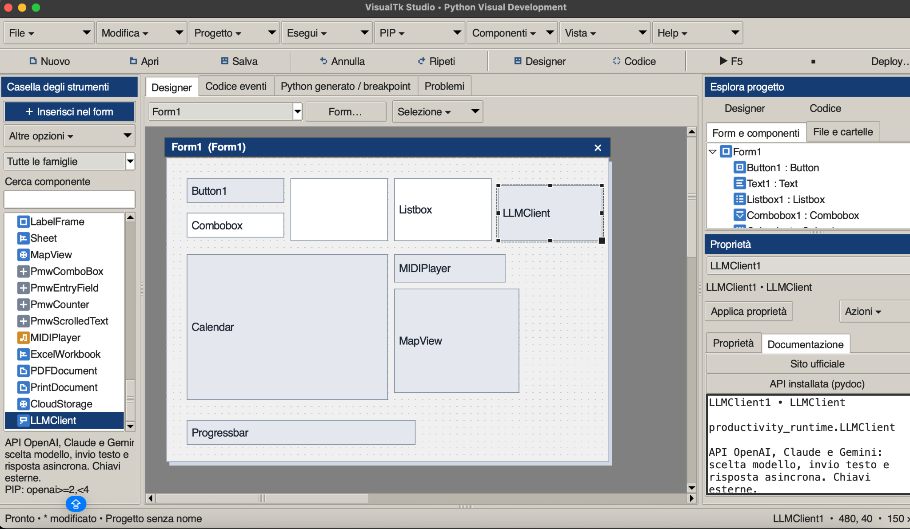

# TkVisualFoundry 1.30

**A visual Python/Tkinter IDE inspired by Visual Basic 6.** Design forms, add components, edit properties, write event handlers, manage project files, run/debug applications and prepare deployment kits from one workspace. IDE installer scripts target macOS and Windows; generated projects include native build workflows. Windows installation requires platform acceptance.

[Italiano](README_IT.md) · [Changelog](CHANGELOG.md) · [Release notes](RELEASE_NOTES.md)

## TkVisualFoundry — the new name (1.30)

**TkVisualFoundry — Visual Python Studio** is the new name of VisualTk Studio. The repository is now [AngeloErre/TkVisualFoundry](https://github.com/AngeloErre/TkVisualFoundry). Application titles, About/help, generator headers, installer labels and build artifacts use the new brand.

Existing projects, settings, caches, recovery history and private environments remain compatible. Internal storage directories and installer ownership identifiers retain their established names to support updates. The Mac launcher is now `TkVisualFoundry.app`; Windows uses the TkVisualFoundry Start menu shortcut and Apps display name. Owned legacy launchers/shortcuts remain recognized by the uninstaller. See [upgrade and removal compatibility](docs/INSTALL_UNINSTALL.md#rename-compatibility).

## Screenshots

### Visual designer

VB6-inspired workspace with the component toolbox, form designer, Project Explorer and property inspector.



### Running application

An application running alongside the designer, with standard controls, a calendar and an interactive map.



### Components and documentation

Extended component palette and integrated reference for the LLM client component.



*Screenshots show earlier releases on macOS, before the TkVisualFoundry rename. The IDE supports Italian and English.*

Startup layout fix: Project Explorer and Properties initialize after pane geometry is available, with a wider right dock and minimum visible areas. Valid manual pane sizes are preserved.

## Stack frame selection and uninstallers (1.29)

With **F9** paused, open **Variables / Inspector → Call stack**, select a frame and double-click, press Enter or choose **Select frame**. The debugger selects that function; locals, selected-module globals and Watch paths follow its context. The selected frame has a ▶ marker. **Show line** reaches generated-source positions; external source files are not opened automatically. Selection uses a pause token so stale requests cannot switch a later stop.

The IDE now includes **Uninstall_Mac.command** and **Uninstall_Windows.cmd** with ownership checks and preservation of personal/modified files. A new **Install_Windows.cmd** creates the IDE environment, Start menu shortcut and Windows Apps uninstall entry. Generated Mac deployment kits include a Trash-based app uninstaller; Windows Setup retains its native uninstaller. [Installation, removal and platform-test limits](docs/INSTALL_UNINSTALL.md).

## Persistent Watch panel (1.28)

Open **Watch** (or **Debug → Watch** in Output/Debug), add paths such as `self.counter`, `self.samples[0]` or `config['port']`, and launch with F5/F9. Watches are saved with the project, show scope/type/value, expand captured containers and accent changes. Explicit `globals.name`, `locals.name` and `last.name` prefixes select available scopes. Smart rename updates `self.ComponentName` references.

This first stage reads existing inspector samples; it does not execute calls/arithmetic or user properties. Values absent from the bounded sample are marked unavailable. Monitoring must be enabled; opening another project cannot reuse the previous project's values. [Watch guide and limits](docs/WATCHES.md).

## Breakpoints in event code (1.27)

Place the cursor on an event-code line and choose **Breakpoint → Toggle line · ⇧F9**, or press **Shift+F9** inside the editor. A red background marks it. The same controls support project startup/import code. Save the project to retain breakpoint metadata. The same menu clears all markers for the current code scope.

**F9** resolves these positions into the current generated source, including code with embedded component runtimes. Click Continue at the initial pdb stop, then trigger the event. The variable inspector shows the stopping point's values. Inserted lines shift markers, edited lines retain their relative position, deleted lines remove their markers with a log notice. Smart rename preserves metadata. Mapping is a text-diff approximation for larger rewrites: review markers after rearranging code. Non-executable/unresolved points are logged and skipped, never moved silently to the next statement. Stop the active debug session before changing markers. Legacy generated-source breakpoints remain session-only; F5/export/deploy do not activate breakpoints.

Try `examples/Debugging/VariableInspectorDemo.vtk.json`, which includes a breakpoint before incrementing the counter.

## Live variable inspector (1.26)

Open **Variables / Inspector** or click **Inspector** in Output/Debug, then start with **F5** or **F9**. The read-only tree shows sampled locals, globals, Application `self` attributes and a call stack. Expand standard containers, filter names and spot changed values. The checkbox enables monitoring for the next launch.

Samples refresh about every **0.5 seconds** during execution and at debugger stops. Returning-function locals remain labeled as **Last locals** when no project frame is active. Values are bounded excerpts; complex objects are summarized without evaluating user properties or repr. This is sampled observation, so brief locals and intermediate assignments may be missed. Exported/deployed applications are not instrumented. See [Variable inspector](docs/VARIABLE_INSPECTOR.md) for scopes, performance and limits. Try `examples/Debugging/VariableInspectorDemo.vtk.json`: click Increment and observe `self.counter` and `self.samples`.

## Visual debug position (1.25)

Press **F9** to launch pdb. The Output/Debug panel shows the current generated-source line and function; **Show line** opens it with a yellow highlight. Continue/Next/Step clear the marker while the program runs. Library frames are reported as outside the generated source.

During debug, the generated-source tab displays the immutable session source; project edits apply on the next launch. Stop debug before changing breakpoints by double-clicking. Existing pdb console, stack and locals commands remain available. This stage observes pdb output; it does not provide a graphical variable/watch editor. Runtime GUI pauses at breakpoints as expected.

## Adaptive edge anchors — first stage (1.23)

Select one or more controls and use **Edit → Adaptive anchors…** or inspector Actions. Left/top preserves position, right/bottom follows the container edge, opposite edges stretch the control and no edges centers it relative to the container size change. Set minimum stretched dimensions or restore fixed placement. The designer keeps the original coordinates; use **F6 preview** or run and resize the window to see adaptation.

This stage supports Tk/ttk-style geometry on forms, ordinary Frame/LabelFrame/TFrame/TLabelframe/Canvas containers and Notebook pages. Page client sizes are calibrated from actual theme insets, including pages first opened after a resize. Nested ordinary frames can each adapt. CustomTkinter controls and children inside scrollable containers are explicitly rejected for now; they still need code-managed layout. A tab container itself can be anchored when its own geometry is Tk-style. This is edge anchoring, not a visual grid/pack editor. Minimum dimensions must not exceed the designed size; when the window is too small, minimum size wins over fitting both edges.

Bindings are coalesced and added without replacing existing handlers; helpers are embedded in standalone/deployment/preview source. Existing projects without layout settings keep fixed placement. 218 tests passed per language, 11 graphical tests skipped; real resize interaction remains pending.

Try `examples/Layout/NotebookAnchorsDemo.vtk.json` for two resizable pages, or `examples/Layout/AnchorsDemo.vtk.json` for nested stretching and a bottom-right button.

## Local history and recovery (1.22)

Open **File → Local history and recovery** or the status-bar snapshot button. Modified project models and pending event/startup/import editor text are copied every 60 seconds to private local application storage, outside project/deploy folders. Saves and explicit local checkpoints also create versions; identical states are deduplicated and the latest 30 snapshots per project path (or untitled session) are retained. The browser lists up to 300 recent snapshots across projects, including previous launches.

Select a version for a bounded JSON difference view; **Open as recovered copy** opens it under a new `-recovered` name without writing over the original or an existing recovered file. The copy is unsaved until you save it. Pending syntax errors are preserved so work can be repaired. Resource files, credentials outside the project, virtual environments and separate file-editor buffers are not backed up: original resource folders are still required. Missing original folders block recovery until restored.

Automatic snapshots can be disabled in Configuration. Existing local copies remain available; declining a normal project save does not erase history. Writes are atomic and failures are reported in the status/log without replacing previous snapshots. This is periodic local recovery, not a backup of the entire project directory.

211 tests passed per language, 11 graphical tests skipped. Pending-code capture, retention/deduplication, failed writes, corrupt records, bounded comparison and recovery-name collisions tested. Interactive history/recovery acceptance remains pending.

## Reviewed smart rename (1.21)

Select a form/control, then use **Edit → Smart rename…** or the inspector Actions menu. Review the proposed identifier/source/parent changes before applying one undoable project transaction. Static `self.Name`, generated event-method references, literal `show`/`hide` form names and literal reflective self access are updated. Visible text, comments, generic strings and external Python files remain unchanged.

Ambiguous class/nested-self references and dynamic accesses are flagged for manual review; this is not whole-program refactoring. Syntax errors, invalid/reserved/colliding names and a project changed during review block application. The project source is parsed, never executed. Unicode source offsets are handled without reformatting the rest of the code.

204 tests passed per language, 11 graphical tests skipped. Refactor transformations, preservation, collisions, Unicode and shadowing covered; interactive review/undo remains to be validated.

## Real form preview (1.20)

Press **F6**, use **Run → Preview**, or the designer Preview button to open the current form in a separate process using the selected project Python. Repeat to refresh the snapshot; **Run → Close preview** closes only the preview, independently of the running/debugged application. Interpreter checks and process output run off the Tk thread.

Preview renders standard Tk/ttk, CustomTkinter, calendar, selected Pmw and Sheet controls with project themes and active tab pages. Events, project imports/startup source and callback/Tcl focus options are removed from a deep copy; incomplete event code does not prevent visual preview. Device, database, network/service and user-defined external controls become labeled placeholders. Package preparation uses only the rendered controls/theme requirements. Themes and approved library initialization still run; this is not a sandbox for untrusted theme/library code. Changes in preview widgets do not update the designer or project.

198 tests passed per language, 11 graphical tests skipped. Snapshot isolation, callback removal, tab/form selection and independent process ownership tested. Real graphical appearance and target-platform preview interaction remain pending.

## Three workflow upgrades (1.19)

**Multiple selection:** Shift-click controls to add/remove them; Ctrl/Cmd+A on the canvas selects visible controls. Drag or nudge the group, duplicate/delete it, and use Designer → Selection for alignment, equal sizes and distribution. The primary control supplies alignment/size values; property fields still edit the primary control. Layout operations require the same parent/page, while nested selected children follow their selected parent only once. Only the primary control has resize handles.

**Problems:** open Run → Problems and analyze the project. The panel lists syntax errors, unrecognized `self` references and modules absent from the selected interpreter/local project module inventory. Double-click an item to open the event/startup/import source at its location. Analysis never executes project event source. Reference/import diagnostics are warnings, not proof that dynamic code is broken; rerun after edits.

**Project Python environment:** save the project, then use Project → Project Python environment → Create / use .venv and prepare packages. Environment creation runs in the background, validates stable Python/Tkinter and reuses existing valid environments without overwriting other folders. The PIP wizard then prepares Jedi and project requirements. The choice is stored in the project and restored on reopen; global IDE preferences keep the global Python. Missing environments are not silently replaced by the global interpreter. Switch back with Use global interpreter. Virtual environments are not portable: move project/source/resources without .venv, then recreate the environment on the destination. They are excluded from deployment kits.

See [work plan and validation checkpoints](WORK_PLAN.md). 191 tests passed per language, 11 graphical tests skipped. Graphical selection/navigation/onboarding still require interactive acceptance.

## Application icons (1.18)

In **Deploy… → Application icon**, choose a square PNG, ICO or ICNS image (256–4096 px; a transparent 1024 px PNG is recommended). The image is imported into the project with a preview; remove the selection to restore default icons. Deployment uses Pillow to generate ICNS for the Mac app, ICO for Windows executable/Setup and PNG for runtime windows. Files are included automatically in the kit; the selected path is stored relative to the project. Pillow is now an IDE requirement; deployed apps use Tk for the PNG icon and do not need Pillow solely for their icon. Build on each target OS as before. Icon appearance in Dock/taskbar depends on OS caching and platform behavior.

## In-app package catalog (1.17)

Use **PIP → Package catalog…** (or Install a package…) to browse **Recommended**, **All PyPI** and **Installed** packages without opening a browser. Search by partial project name, browse pages of 100 results, select a package for description/license/project URLs and its latest Python-compatible stable release, then install through the existing wizard or add a pinned project requirement. **Exact name…** retrieves a known package directly without downloading the full index.

All PyPI uses the official Simple Index, downloaded on first access in a background task and cached locally. Subsequent name searches can use that cache offline; metadata and installation still need network access. Use **Refresh index** for new projects/updates; caches older than 24 hours are marked. Global search matches names, not full descriptions. No package code is imported to browse the catalog; PIP still checks dependencies and platform/wheel availability.

176 tests passed in each language, with 11 graphical tests skipped. A live index download returned 938,819 project names during validation; counts change over time. Graphical interaction remains to be checked.

## Reliability fixes (1.16)

Recover malformed local settings and invalid colors, reset event-editor context/native undo when switching or restoring projects, preserve previous files on failed saves, cancel queued startup checks on shutdown and ignore obsolete installed-API responses after an interpreter change. Dependency reports now depend on requirements/interpreter/documentation URLs rather than unrelated code edits. Project-local component API documentation resolves from the project directory. Invalid geometry is rejected before rendering, and analysis-worker exit races are handled.

Validation: **167 tests passed in each language (Italian and English), 11 GUI tests skipped per run**. All 12 example projects validated and compiled; installed Tkinter documentation, Python syntax, installer shell syntax and local README links checked. Interactive graphical workflows, Windows/native target installs and live devices/services remain outside this validation.

## VB6-inspired workspace (1.15)

Toolbox on the left, designer/code in the center and a vertically split Project Explorer/Properties dock on the right. Compact icon toolbar, in-window tooltips, object/event selectors, searchable categorized/alphabetical properties and live geometry status. The designer has a classic form title strip and eight active resize handles with grid snapping and cursor feedback. F7 opens code; Shift+F7 returns to the designer.

New installations default to VB6 Classic: gray chrome, blue captions and a white editor with adapted syntax colors. Existing custom colors are preserved; choose **View → VB6 Classic** to apply the preset. Light/Dark/Sepia and custom appearance remain available. This recreates a VB6-style workflow inside Tk rather than a floating-window/MDI clone.

## Install or update

1. Download and extract the repository/source ZIP into a writable folder.
2. Double-click `Install_Mac.command`, or run `bash Install_Mac.command` in Terminal.
3. The installer finds **stable Python 3.15+ with Tkinter**, prepares a private virtual environment and creates `TkVisualFoundry.app` in `~/Applications`.
4. Launch the app and select the project interpreter in **Project → Configuration…**.
5. Optional component packages are prepared through the PIP wizard when needed.

Run the new installer to update the installed app and its modules. Keep `.vtk.json` projects and their resources in separate project directories. If no compatible Python is available, the installer attempts setup through an existing Homebrew installation; otherwise it opens the Python website. Prerelease Python is rejected. Tkinter is supplied with the Python/Tcl/Tk installation, not installed through PIP.

The core requirements are Jedi, PyInstaller, packaging and certifi. Multimedia, database, cloud and AI dependencies are optional. Internet access is needed for initial package installation and online checks. The IDE requires a graphical macOS session; Python and native libraries must match the machine architecture. Public signing/notarization is a separate release step.

## Quick start

1. Open `examples/Saluto.vtk.json` or create a project.
2. Filter the component palette by name/family, then double-click a component to insert it.
3. Drag to position, use the resize handle and edit the inspector properties.
4. Double-click a control to open an event body; write Python without its surrounding `def`.
5. Save and press **F5**. Use **Deploy…** when ready to package the project.

```python
# Example Button1 Click event
self.Button1.configure(text="Operation completed")
messagebox.showinfo("Information", "Your application is running")
# With another form named Form2:
# self.show("Form2")
```

## Workspace, designer and project management

| Feature | What it does | How it is implemented |
|---|---|---|
| Visual designer | Insert, select, move, resize, align, duplicate and delete controls; grid snapping and keyboard nudging | A schematic Tk Canvas edits the project model; `core.py` generates the executable UI |
| Multiple forms | Create, switch, duplicate and delete forms; show/hide forms from code | Named forms and event bodies are stored in `.vtk.json`; generated applications expose `self.show()` / `self.hide()` |
| Nested containers and tabs | Place controls in frames/tab pages, choose visible pages and manage subtrees | Explicit `parent`/`page` relationships, parent-relative coordinates, hierarchy validation and parent-first generation |
| Property inspector | Edit names, geometry, text, colors, fonts and component configuration | Typed model values, color/font dialogs and specialized setup dialogs; persistent actions above scrollable properties |
| Undo/redo | Restore designer/model changes | Project snapshots; file-system operations have their own recoverable trash and are not designer undo actions |
| Project explorer | Create/import/rename files and folders; edit UTF-8 files; choose deployment resources | Relative project paths, separate text editors and an explicit resource list in the project model |
| Project persistence | Open, save and export projects without losing event source | JSON project model, validation, dirty-state prompts and generated standalone Python source |
| Organized workspace | Drop-down menus, component icons, resizable panels, collapsible output and layout reset | Tk/ttk panes and menus; log sizing preserves working space for the designer and component actions |

Container duplication includes descendants; form duplication remaps parent names. User event code stays verbatim, so review references after renaming/duplicating controls. File renames do not rewrite imports or resource paths. The file explorer skips technical/hidden folders and symlinks, displays up to 1,500 entries and opens UTF-8 files up to 2 MB. See [project files and deployment](docs/en/DEPLOYMENT.md).

## Code editor and IntelliSense

| Feature | What it does | How it is implemented |
|---|---|---|
| Event and project code | Edit component/form events, startup code, imports and global helpers | Event bodies are associated with named objects and assembled into generated application methods |
| Editing assistance | Syntax highlighting, indentation, completion navigation and contextual examples | Tk text editor, token-based highlighting and project-aware snippet/method/property metadata |
| Python/library completion | Suggest members after `messagebox.`, `self.Button1.` or imported aliases | Jedi runs in a separate persistent process using the configured project Python; user event source is analyzed statically |
| Call signatures | Show parameters, the active argument and symbol descriptions | Semantic results and local fallback metadata; obsolete results are discarded after edits/context changes |
| Guided values | Insert paired quotes for known text properties; suggest boolean, current and enum values | Token-aware detection of `configure`/`config` keyword values, using designer values and registered component defaults |
| Component examples | Show useful operations for the selected component/event and insert snippets | Registry-backed examples for common controls, database operations and advanced service components |

For example, typing `self.Button1.configure(text=` inserts `''` and leaves the cursor inside. It also works when accepting `text=` from completion. Type the closing quote to step over the generated quote; Backspace in an empty generated pair removes both. Known numeric values are not quoted. Existing values, comments and literals are preserved. External components benefit from typed descriptor defaults; unknown/dynamic APIs depend on available Jedi/type information rather than speculative value insertion.

Use **Ctrl+Space** for suggestions, **Enter/Tab** to accept and **Esc** to close. The **Engine…** action prepares Jedi if missing in the selected interpreter. Automatic text-quote guidance can be disabled in Configuration. See [IntelliSense guide](docs/en/INTELLISENSE.md).

## Components, libraries and application themes

| Family | Available controls/integrations | Implementation notes |
|---|---|---|
| Standard Tkinter | Button, Label, Entry, Text, Checkbutton, Radiobutton, Listbox, Scale, Spinbox, Frame, LabelFrame and Canvas | Native Tk widgets emitted by the Python generator |
| ttk | Combobox, Progressbar, Treeview, Notebook and expanded button/label/entry/check/radio/scale/spinbox/frame/labelframe/separator/scrollbar/menubutton/sizegrip/panedwindow palette | Native themed widgets; tabs use a project-aware adapter |
| CustomTkinter | Buttons, labels, entries, switches, checkbox/radio, slider/progress, option/combo/segmented selectors, textboxes, frames, scrollable frames and tabs | Registered classes and adapters; constructor geometry and independent System/Light/Dark appearance |
| Advanced data and utility controls | Calendar, DateEntry, Sheet, MapView, ScrolledText and selected Pmw ComboBox/EntryField/Counter/ScrolledText controls | tkcalendar, tksheet, tkintermapview, standard ScrolledText and Pmw integrations |
| Files and dialogs | FileDropZone, FileBrowserButton, AdvancedFileBrowser and MessageButton | TkinterDnD2 drag/drop, native or tkfilebrowser file dialogs, message/input/color dialogs |
| Web | HtmlView, WebView and NativeWebButton | tkhtmlview, tkinterweb and a separate pywebview process |
| Images, media and devices | ImageGallery, AudioPlayer, WebcamView, USBExplorer and SerialMonitor | Pillow, pygame-ce, OpenCV/NumPy, PyUSB and pyserial; runtime controls and events |
| Video and streams | VideoPlayer, LegacyVideoPlayer and YouTubePlayer | VLC integration, optional legacy tkVideoPlayer and yt-dlp or alternative stream resolvers |
| Project themes | ttkbootstrap 1.x, ttkthemes, Sun Valley (`sv-ttk`), Azure and Forest | One ttk theme provider per project; Azure/Forest import local Tcl/image resources |
| External components | Create a component through a wizard or import a JSON descriptor | Validated module/class/defaults/requirements metadata; palette registration without executing plugin code during descriptor import |

The library manager lists integration types, requirements and interpreter-scoped results; it can run isolated import and representative GUI checks. The palette supports family filtering. Project themes and IDE appearance are separate settings. The preview is **schematic**: it does not instantiate external controls or reproduce every style/scrolling detail. TPanedwindow sections are managed through code. Tix is unsupported; PySimpleGUI, FreeSimpleGUI and guizero are informational separate-engine entries, not generated project backends.

Guides: [libraries/themes/containers](docs/en/LIBRARIES.md), [external components](docs/en/EXTENSIONS.md), [compatibility](docs/en/COMPATIBILITY.md).

## Local and remote databases

**DatabaseView** combines connection configuration, table display and ready-to-use record operations.

| Capability | Implementation |
|---|---|
| SQLite, PostgreSQL and MySQL | Python `sqlite3` for SQLite; SQLAlchemy with psycopg/PyMySQL for remote servers |
| Table selection and data display | Schema inspection and a ttk table with configurable row limits |
| Add, edit, update, delete and refresh | Transactional operations, bound values and primary-key-based updates/deletes; contextual code examples |
| Responsive operations | A worker owns the database session and returns results through Tk events such as DatabaseConnected/DataLoaded/DataChanged |
| Credentials | Passwords supplied at runtime or through an external environment variable rather than stored as component password properties |

SQLite needs no PIP package. The wizard prepares remote-driver requirements when the backend changes. Tables without a primary key cannot be updated/deleted through the record editor. DatabaseView is not a server administration tool. See [database guide](docs/en/DATABASE.md) and `examples/Database.vtk.json`.

## MIDI, Excel, PDF, printing, cloud and AI

| Component | Features | How it is implemented and key limits |
|---|---|---|
| MIDIPlayer | Output discovery, MIDI playback, pause/resume and stop | mido/python-rtmidi send MIDI commands to a synthesizer output; no audio synthesizer is bundled |
| ExcelWorkbook | XLSX/XLSM workbooks, sheet/cell operations, table preview, create and save copies | openpyxl; formulas are preserved rather than evaluated; no XLS/XLSB support or macro execution |
| PDFDocument | Text extraction, text preview, merging and selected-page export | pypdf with crypto support; no graphical PDF renderer or OCR |
| PrintDocument | Open a document for preview and submit confirmed print requests | Associated application for preview; macOS `lp`/CUPS or Windows print verb; successful submission does not guarantee physical printing |
| CloudStorage | List, upload and download through Google Drive, S3/MinIO or WebDAV | Provider-specific backends; Drive Desktop OAuth/ADC, AWS/session credentials or WebDAV HTTPS credentials; no full sync client |
| LLMClient | List models, send text prompts, read responses and usage | Official OpenAI Responses, Claude Messages and Gemini Generate Content SDKs; single requests without automatic conversation history, tools or attachments |

Configuration dialogs collect provider options and prepare only relevant packages. Slow service operations run in worker threads; completion/error events are delivered on the Tk thread. Runtime session secrets stay in memory; project configuration stores environment variable names, and Drive tokens remain outside the project. The designer does not connect accounts or send paid AI requests. Provider API accounts, consent, quota/billing, printers, synthesizers, drivers and native libraries must be supplied separately. Chat-app subscriptions do not automatically grant API access.

See [documents, cloud and LLM guide](docs/en/PRODUCTIVITY.md) and `examples/Productivity/`.

## PIP wizard and startup checks

| Feature | What it does | How it is implemented |
|---|---|---|
| Dependency guidance | Explain requirements before insertion/run and prepare missing packages | Component/provider-specific requirements in the configured project interpreter; automatic preparation is configurable |
| Installation wizard | Verify versions/imports, install packages, show progress/logs, cancel and check conflicts | Separate subprocesses, PIP/ensurepip, dependency probes and consistency checks; optional wheels-only mode |
| PyPI explorer | Find packages, inspect metadata and prepare installation | Package lookup UI linked to interpreter-scoped installation |
| Startup package audit | Check PIP, declared project/IDE requirements, all installed distribution metadata and `pip check` | Background inventory subprocess plus bounded network workers |
| Stable update candidates | Show newer releases compatible with Python and declared constraints | PyPI release metadata, packaging version/specifier handling, exclusion of prerelease/development/yanked files |
| Reviewable updates | Prepare updates to declared requirements while preserving extras/constraints | Existing PIP wizard; transitive packages are resolved by PIP, not independently mass-upgraded |

For WebcamView, for example, the wizard explains and prepares **opencv-python, NumPy and Pillow**. It cannot grant camera permissions or install every external system dependency. Optional unused libraries are not all installed.

Use **PIP → Startup checks** or the inspector button to view results and run checks again for the current project/interpreter. Startup checks and guided quoting can be disabled in Configuration. Network failures remain unverified rather than blocking the editor. Python-version metadata alone does not prove that a compatible wheel, native driver or working import exists; the installation wizard performs further checks. [Packages guide](docs/en/PACKAGES.md).

## Component documentation and help

The inspector **Documentation** tab displays an offline reference with properties, methods, examples and requirements. An official-site button opens the relevant documentation. **Installed API (pydoc)** imports the selected component module in an isolated subprocess with a timeout to show the installed API's documentation; it does not execute project events. External descriptors may provide a validated HTTPS `documentation` URL.

Documentation links are checked in the background at each startup. Redirects are followed; HTTP 404/410 mean broken links. Restrictions, network/certificate errors and temporary server failures remain unverified. Links are never silently removed or rewritten; local reference text remains available offline. Built-in help also offers topic selection, search, examples and environment diagnostics. Installed library docstrings may be in their original language.

## Run, debug, export and deploy

| Feature | Implementation |
|---|---|
| Run and stop | Generated application runs in a separate process using the project interpreter; output is streamed to the IDE log |
| Syntax validation | Compile/check generated Python before running/exporting |
| Debugging | Python pdb process, breakpoints from the generated source and continue/next/step/stack/locals commands |
| Standalone Python export | Deterministic generator embeds the required internal adapters and language/theme support; third-party packages/resources remain dependencies |
| Deployment kit | Export source, included files, project, requirements, metadata, instructions and target-specific run/build/install scripts |
| Native builds | PyInstaller with collection flags for active libraries, themes, fonts, Tcl/native assets and certificates; optional build on the current computer |
| macOS distribution | `.app` and DMG; ZIP fallback when disk-image creation is unavailable; installation into `~/Applications` |
| Windows distribution | Executable directory and portable ZIP; optional Setup installer through supplied Inno Setup configuration |

Build separately on each target OS/architecture: a Mac does not cross-compile Windows executables. Windows Setup requires Inno Setup. Native application recipients do not need Python, but drivers, VLC, permissions and service credentials may still be required. Public signing/notarization and testing on clean targets are separate steps. Include only intended resources, retain licenses and keep writable data outside the application bundle. See [deployment guide](docs/en/DEPLOYMENT.md).

## Language and appearance

Choose **Project → Configuration → Appearance** for **Italiano / English**, save and restart. Italian is the default; `VTS_LANGUAGE=it` / `VTS_LANGUAGE=en` overrides the launch language. Generated component labels have a separate project language setting. Existing code, identifiers, text and data are not translated.

Light, Dark and Sepia IDE presets and custom colors are persisted locally with editor font size, grid, interpreter and package preferences. Application themes affect generated projects independently of the IDE palette.

## Architecture and development

| Modules | Responsibility |
|---|---|
| `studio.py`, UI mixins, `component_palette.py`, `ux_theme.py` | Desktop workspace, designer, menus, inspectors and appearance |
| `core.py`, `components.py`, `hierarchy.py` | Project validation, component registry, container relationships and Python generation |
| `assist_ui.py`, `analysis_client.py`, `intellisense_worker.py`, `semantic_engine.py`, `editor_guidance.py` | Completion UI, isolated semantic analysis and guided values |
| `dependency_manager.py`, `dependency_ui.py`, `startup_checks.py` | Interpreter-scoped package preparation and background health checks |
| `component_docs.py`, `intelligence_ui.py`, `support_ui.py`, `i18n.py` | Component references, audit results, help and bilingual UI |
| Runtime adapters and `service_backends.py` | Generated application's device, database, library, document, cloud and AI operations |
| `project_files.py`, `deployment.py`, `deploy_build.py` | Project resources, build kits and native packaging |

Launch from source with `python3 studio.py` in a supported environment after installing `requirements.txt`. `Build_Mac.command` packages the IDE itself. Run the test suite from the repository directory:

```bash
VTS_LANGUAGE=it python3 -m unittest discover -s tests -q
```

**Version 1.14 validation:** 151 tests passed, 11 graphical tests skipped. The English semantic suite passed 20 tests with one GUI test skipped. Real document operations, SDK imports, representative PyPI/link checks and earlier native Mac example app/ZIP builds were verified. Cloud/LLM/MIDI/printing contracts use mocks; no paid generation, account operations or physical printing occurred. Interactive GUI typing/focus, full graphical app execution, Windows builds and clean-target installs still require validation.

## Guides and examples

- [IntelliSense, documentation and startup checks](docs/en/INTELLISENSE.md)
- [Packages and environment](docs/en/PACKAGES.md)
- [Libraries, themes and containers](docs/en/LIBRARIES.md)
- [Database and CRUD](docs/en/DATABASE.md)
- [MIDI, Excel, PDF, printing, cloud and LLM](docs/en/PRODUCTIVITY.md)
- [Project files and deployment](docs/en/DEPLOYMENT.md)
- [External components](docs/en/EXTENSIONS.md)
- [Examples](docs/en/EXAMPLES.md) · [Compatibility](docs/en/COMPATIBILITY.md)

Examples include `examples/Database.vtk.json`, `examples/Libraries/`, `examples/Productivity/` and `examples/ProjectFiles/ProjectFilesDemo.vtk.json`.
