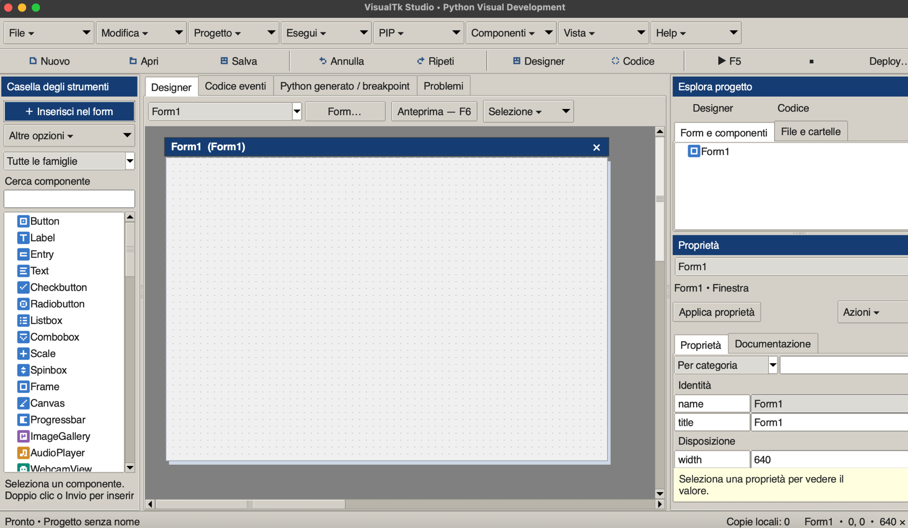
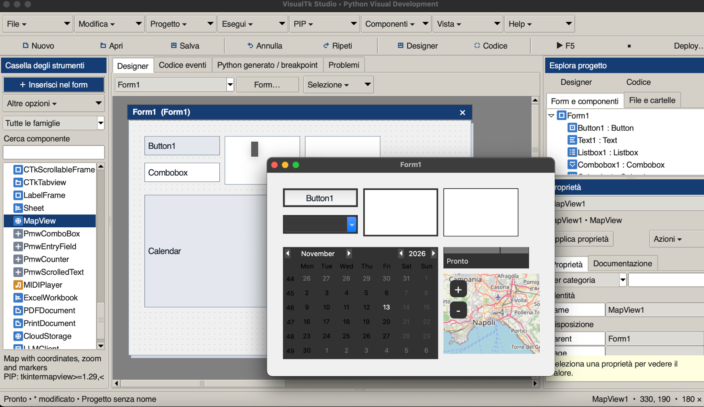
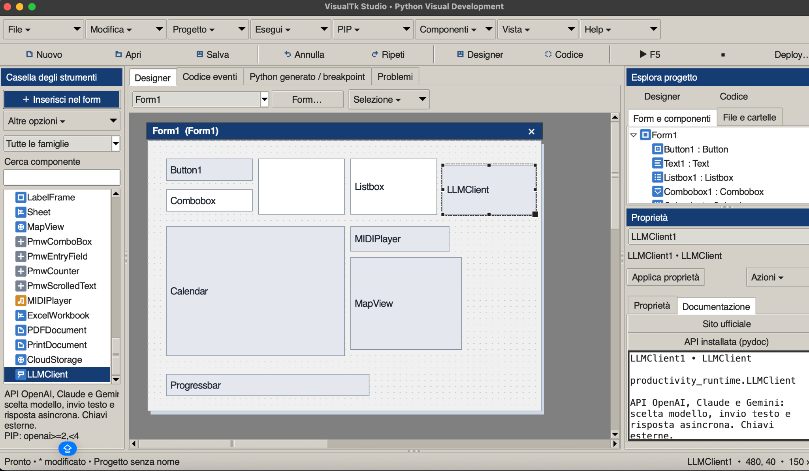

# TkVisualFoundry 1.39

**IDE visuale Python/Tkinter ispirato a Visual Basic 6.** Permette di disegnare form, aggiungere componenti, modificarne le proprietà, scrivere eventi, gestire file, eseguire/debuggare applicazioni e preparare il deploy da un unico ambiente. Gli script di installazione dell’IDE sono per macOS e Windows; i progetti generati comprendono procedure di build native. L’installazione Windows richiede collaudo sulla piattaforma.

[English README](README.md) · [Cronologia](CHANGELOG.md) · [Note di rilascio](RELEASE_NOTES.md)

## Quinto gruppo di modelli (1.39)

Aggiunti **Rubrica contatti**, **Gestionale spese**, **Inventario casa/magazzino** e **Archivio CD/DVD/giochi**: ora **20 modelli più il progetto vuoto**, con commenti in inglese e senza PIP aggiuntivi. La rubrica salva in SQLite dedicato e mostra foto PNG/GIF; gli altri archivi salvano JSON atomico. Spese con totali decimali per valuta, inventario con codici univoci e soglie di scorta. Collaudo Mac ancora in attesa di “ambiente collegato”. [Guida ai modelli](docs/STARTER_TEMPLATES.md).

## Quarto gruppo di modelli (1.38)

Aggiunti **Calcolatrice scientifica**, **Orario settimanale**, **Ricettario** e **Catalogo libri**: ora **16 modelli più il progetto vuoto**, con commenti in inglese e senza PIP aggiuntivi. La calcolatrice usa un AST limitato; i tre archivi includono ricerca, aggiunta/modifica/eliminazione e salvataggio JSON atomico. L’orario rifiuta lezioni sovrapposte. Collaudo nativo Mac ancora in attesa della riconnessione. Consulta la [guida ai modelli](docs/STARTER_TEMPLATES.md).

## Terzo gruppo di modelli (1.37)

Aggiunti **Sveglia e timer**, **Blocco note a schede**, **Tracker di abitudini** ed **Editor Pixel Art**, con commenti in inglese e senza PIP aggiuntivi. Ora sono disponibili **12 modelli più il progetto vuoto**. Sviluppo e test automatici sono stati eseguiti su Linux remoto con il Mac scollegato. Le verifiche native attendono il messaggio “ambiente collegato”: consulta la [checklist](docs/MAC_RECONNECT_CHECKLIST.md) e la [guida ai modelli](docs/STARTER_TEMPLATES.md).

## Altri quattro modelli (1.36)

Altri quattro modelli in **File → Nuovo progetto**: **Trova l’intruso**, **Memory**, **Gioco del 15** e **Mini-Paint**. Ora sono disponibili **8 modelli più il progetto vuoto**, con codice commentato in inglese e controlli modificabili nel designer. Memory protegge il riavvio dai timer precedenti; il Gioco del 15 viene mescolato con mosse legali; Mini-Paint esporta in EPS. Consulta la [guida ai modelli](docs/STARTER_TEMPLATES.md).

## Modelli per nuovi progetti (1.35)

**Nuovo progetto** apre un selettore con progetto vuoto e quattro modelli pronti: **Quiz**, **Simulatore di dadi**, **Convertitore di testi** e **Post-it digitali**. Il codice è commentato in inglese, i controlli sono modificabili nel designer e non servono pacchetti PIP aggiuntivi. Ogni modello diventa una copia indipendente, ancora da salvare. È il primo gruppo della raccolta proposta di 32 modelli. Consulta la [guida ai modelli](docs/STARTER_TEMPLATES.md).

## Ricerca globale e navigazione (1.34)

Usa **Modifica → Ricerca globale…** o **Ctrl/Cmd+Maiusc+F** per cercare testo negli eventi, nel codice di avvio/import e nei file Python della cartella del progetto salvato. I contenuti non salvati degli editor hanno precedenza sui file. Doppio clic o Invio su un risultato apre la sorgente e seleziona il testo. Disponibili maiuscole/minuscole e parola intera, ricerca in background interrompibile e controllo dei risultati obsoleti. Consulta la [guida alla ricerca globale](docs/GLOBAL_SEARCH.md).

## Correzioni di recupero e gerarchie (1.33.1)

Gli eventi e il codice di avvio con soli commenti o spazi ora compilano senza modificare il testo salvato. Si aprono i progetti UTF-8 con BOM. L’ordinamento iterativo dei contenitori gestisce gerarchie profonde e continua a rilevare i cicli. Consulta il [resoconto del debug aggiuntivo](docs/DEBUG_REPORT_1.33.1.md).

## Stress test and debugging (1.33)

Versione di stress test e debug generale: rifiuto dei nomi Unicode ambigui e delle strutture progetto/eventi non valide prima dell’apertura, confronto dati che distingue i tipi, chiusura robusta dei lettori. Consulta il [resoconto con verifiche riproducibili](docs/DEBUG_REPORT_1.33.md).

## Colorazione del Python generato (1.32.1)

Il Python generato colora parole chiave, stringhe, commenti e numeri, adattandosi al tema. Breakpoint, riga corrente di debug e selezione restano prioritari. Il codice generato invariato non viene ricolorato inutilmente.

## Visualizzatore dati (1.32)

Apri **Progetto → Visualizzatore dati…** per controllare SQLite, Excel, JSON, CSV/TSV, script SQL e i lettori opzionali Access/DBF/Parquet. Tabelle e fogli in sola lettura, filtro, aggiornamento ogni due secondi e confronto con il campione iniziale aiutano a verificare le scritture della tua applicazione. **Prepara lettore PIP…** usa il Python del progetto. Access richiede anche un driver ODBC di sistema; DBX viene riconosciuto solo se contiene SQLite. Il confronto riguarda massimo 500 righe, 80 colonne e 512 caratteri per cella, non l’intera base dati. Consulta la [guida ai formati](docs/DATA_VIEWER.md).

## Una sola barra dei menu (1.31.1)

Una sola barra dei menu nativa: in alto sullo schermo su macOS, nella finestra su Windows/Linux. Rimossa la barra interna duplicata; restano disponibili la toolbar dei comandi rapidi e la palette dei comandi.

## Palette dei comandi (1.31)

Premi **Ctrl+Maiusc+P** (Windows/Linux) o **Cmd+Maiusc+P** (macOS), oppure scegli **Modifica → Cerca un comando…**. Cerca le azioni dei menu in italiano o inglese, seleziona con ↑/↓ e premi Invio. Esc chiude la palette e ripristina il focus precedente. La ricerca vuota mostra prima i comandi recenti della sessione. Le azioni richiamano i gestori dei menu esistenti, conservandone i controlli di contesto. Il testo cercato non viene eseguito come codice.

## TkVisualFoundry — il nuovo nome (1.30)

**TkVisualFoundry — Visual Python Studio** è il nuovo nome di VisualTk Studio. Il repository è ora [AngeloErre/TkVisualFoundry](https://github.com/AngeloErre/TkVisualFoundry). Titoli, Informazioni/guida, intestazioni del codice generato, etichette degli installer e pacchetti usano il nuovo marchio.

Progetti, impostazioni, cache, cronologia di recupero e ambienti esistenti restano compatibili. Le cartelle interne e gli identificativi di installazione conservano i nomi precedenti per consentire l’aggiornamento. Su Mac il launcher è `TkVisualFoundry.app`; Windows mostra TkVisualFoundry nel menu Start e nelle App installate. Il disinstallatore riconosce anche i precedenti launcher/collegamenti gestiti. [Compatibilità di aggiornamento e rimozione](docs/INSTALL_UNINSTALL.md#rename-compatibility).

## Schermate

### Designer visuale

Ambiente ispirato a VB6 con casella degli strumenti, designer dei form, Esplora progetto e ispettore delle proprietà.



### Applicazione in esecuzione

Un’applicazione in esecuzione accanto al designer, con controlli standard, calendario e mappa interattiva.



### Componenti e documentazione

Catalogo dei componenti estesi e documentazione integrata del componente client LLM.



*Le immagini mostrano versioni precedenti su macOS, prima della rinomina TkVisualFoundry. L’IDE supporta italiano e inglese.*

Correzione del layout iniziale: Esplora progetto e Proprietà vengono dimensionati quando la geometria è disponibile, con pannello destro più largo e aree minime visibili. Le dimensioni manuali valide vengono conservate.

## Selezione frame e disinstallazione (1.29)

Con **F9** in pausa, apri **Variabili / Ispettore → Stack delle chiamate**, seleziona una funzione e fai doppio clic, premi Invio oppure **Seleziona frame**. Locali, globali del modulo selezionato e Watch seguono quel contesto. Il simbolo ▶ indica il frame corrente. **Mostra riga** raggiunge le posizioni nel sorgente generato; i file esterni non vengono aperti automaticamente. Un identificativo della pausa impedisce a richieste obsolete di cambiare un arresto successivo.

Aggiunti **Uninstall_Mac.command** e **Uninstall_Windows.cmd** per l’IDE, con verifica dei file installati e conservazione di quelli personali/modificati. Il nuovo **Install_Windows.cmd** prepara ambiente, collegamento Start e voce di disinstallazione in Windows. I kit Mac generati includono un uninstaller che sposta l’app riconosciuta nel Cestino; Windows Setup usa il proprio disinstallatore. [Installazione, rimozione e limiti del collaudo](docs/INSTALL_UNINSTALL.md).

## Pannello Watch persistente (1.28)

Apri **Watch / Osserva** (anche da **Debug → Watch** nel pannello Output/Debug), aggiungi percorsi come `self.counter`, `self.samples[0]` o `config['port']`, quindi avvia con F5/F9. Le Watch vengono salvate nel progetto e mostrano ambito, tipo e valore; i contenitori campionati sono espandibili e i cambiamenti evidenziati. I prefissi `globals.nome`, `locals.nome` e `last.nome` selezionano gli ambiti disponibili. La rinomina guidata aggiorna i riferimenti `self.NomeComponente`.

Questa prima fase legge i campioni dell’ispettore senza eseguire chiamate, calcoli o proprietà dell’utente. I valori assenti dal campione limitato sono indicati come non disponibili. Il monitoraggio deve essere attivo; aprire un altro progetto impedisce di riutilizzare i valori del precedente. [Guida e limiti delle Watch](docs/WATCHES.md).

## Breakpoint nel codice degli eventi (1.27)

Posiziona il cursore su una riga dell’evento e scegli **Breakpoint → Attiva/disattiva riga · ⇧F9**, oppure **Maiusc+F9** nell’editor. La riga diventa rossa. Funziona anche nel codice startup/import del progetto. Salva il progetto per conservare i breakpoint. Lo stesso menu permette di rimuovere tutti i marcatori del codice corrente.

**F9** traduce queste posizioni nelle righe del sorgente generato, anche quando contiene runtime dei componenti. Premi Continua al primo arresto di pdb, poi attiva l’evento: l’ispettore mostra i valori del punto di arresto. L’inserimento di righe sposta i marcatori; le righe modificate mantengono la posizione relativa; eliminare una riga ne rimuove il breakpoint con avviso nel log. La rinomina guidata conserva i metadati. Per riscritture ampie il confronto testuale è approssimativo: ricontrolla i marcatori dopo aver riorganizzato il codice. Punti non eseguibili o non risolti sono segnalati e ignorati, senza spostarli alla prossima istruzione. Arresta il debug prima di cambiare marcatori. I vecchi breakpoint nel Python generato restano temporanei; F5/export/deploy non li attivano.

L’esempio `examples/Debugging/VariableInspectorDemo.vtk.json` include un breakpoint prima dell’incremento del contatore.

## Ispettore delle variabili durante l’esecuzione (1.26)

Apri **Variabili / Ispettore**, oppure premi **Ispettore** nel pannello Output/Debug, quindi avvia con **F5** o **F9**. L’albero in sola lettura mostra locali campionate, globali, attributi `self` di Application e stack. Puoi espandere i contenitori standard, filtrare i nomi e individuare valori cambiati. La casella abilita il monitoraggio per il prossimo avvio.

I campioni si aggiornano circa ogni **0,5 secondi** durante l’esecuzione e ai punti di arresto. Quando non ci sono funzioni attive, le locali dell’ultima funzione osservata restano indicate come **Ultime locali**. I valori sono estratti limitati; gli oggetti complessi sono sintetizzati senza eseguire proprietà o repr dell’utente. Locali molto brevi e assegnazioni intermedie possono sfuggire al campionamento. Le applicazioni esportate non vengono strumentate. [Guida tecnica e limiti](docs/VARIABLE_INSPECTOR.md). Prova `examples/Debugging/VariableInspectorDemo.vtk.json`: premi Increment e osserva `self.counter` e `self.samples`.

## Posizione del debug visuale (1.25)

Premi **F9** per avviare pdb. Il pannello Output/Debug indica riga e funzione del sorgente generato; **Mostra riga** apre il punto con evidenziazione gialla. Continua/Passo/Entra rimuovono il segnale durante l’esecuzione. Le funzioni delle librerie sono indicate come esterne al sorgente generato.

Durante il debug la scheda Python generato mostra il sorgente della sessione avviata; le modifiche al progetto valgono al successivo avvio. Arresta il debug prima di cambiare i breakpoint con doppio clic. Restano disponibili console pdb, stack e variabili locali. Questa fase legge l’output di pdb e non include un editor grafico di variabili/watch. Ai breakpoint la GUI dell’applicazione si ferma come previsto.

## Ancoraggi adattivi — prima fase (1.23)

Seleziona uno o più controlli e usa **Modifica → Ancoraggi adattivi…** oppure Azioni nell’ispettore. Sinistra/alto mantengono la posizione; destra/basso seguono il bordo; due lati opposti allargano il controllo; nessun lato lo centra rispetto alla variazione del contenitore. Puoi impostare dimensioni minime o ripristinare il posizionamento fisso. Il designer conserva le coordinate iniziali: verifica l’adattamento con **F6** o eseguendo e ridimensionando la finestra.

Questa fase supporta geometria Tk/ttk su form e Frame/LabelFrame/TFrame/TLabelframe/Canvas ordinari, anche annidati, e pagine Notebook. L’area interna delle schede viene misurata tenendo conto del tema, anche aprendo una pagina dopo un ridimensionamento. Controlli CustomTkinter e figli interni a contenitori scorrevoli vengono esplicitamente esclusi: richiedono ancora layout da codice. Il contenitore a schede stesso può essere ancorato se usa geometria Tk. Non è un editor visuale grid/pack. Le dimensioni minime non possono superare quelle di progetto; se lo spazio è insufficiente, il minimo prevale sulla distanza dai bordi.

Gli aggiornamenti vengono accorpati senza sostituire altri handler e il supporto è incorporato nei sorgenti esportati, deploy e anteprima. I progetti senza questi metadati mantengono il comportamento fisso. 218 test superati per lingua, 11 grafici saltati; ridimensionamento grafico reale ancora da collaudare.

Prova `examples/Layout/NotebookAnchorsDemo.vtk.json` per due schede adattive oppure `examples/Layout/AnchorsDemo.vtk.json`: espansione annidata e pulsante in basso a destra.

## Cronologia locale e recupero (1.22)

Apri **File → Cronologia e recupero locale** oppure il pulsante nella barra di stato. Il modello modificato e il testo corrente degli editor eventi/avvio/import vengono copiati ogni 60 secondi nello spazio locale dell’applicazione, fuori dal progetto/deploy. Salvataggi e punti locali manuali creano versioni; stati identici vengono deduplicati e si conservano le ultime 30 copie per percorso progetto o sessione senza nome. La finestra elenca fino a 300 copie recenti, anche di avvii precedenti.

Seleziona una versione per confrontarla in formato JSON; **Apri come copia recuperata** la apre con un nuovo nome `-recovered`, senza scrivere sull’originale o su copie già esistenti. La copia rimane da salvare. Anche il codice con sintassi incompleta viene conservato. Non vengono copiati risorse esterne, credenziali esterne, ambienti virtuali o buffer degli editor di file separati: servono ancora le cartelle originali delle risorse. Se la cartella originale manca, va ripristinata prima del recupero.

Le copie automatiche sono disattivabili in Configurazione; quelle esistenti restano disponibili. Rifiutare un normale salvataggio non cancella la cronologia. Le scritture sono atomiche e gli errori compaiono in stato/log conservando le copie precedenti. È un recupero locale periodico, non un backup completo della cartella progetto.

211 test superati per lingua, 11 grafici saltati. Verificati codice non salvato, conservazione/deduplicazione, errori disco, copie corrotte, confronto limitato e collisioni dei nomi recuperati. Il flusso grafico di cronologia/recupero resta da collaudare.

## Rinomina intelligente con anteprima (1.21)

Seleziona un form/controllo e usa **Modifica → Rinomina intelligente…** oppure Azioni nell’ispettore. Controlla le modifiche prima di applicare un’unica operazione annullabile. Vengono aggiornati `self.Nome`, i riferimenti ai metodi evento generati, i nomi form letterali in `show`/`hide`, gli accessi riflessivi letterali a self e i collegamenti parent. Testi visibili, commenti, stringhe generiche e file Python esterni restano invariati.

Riferimenti ambigui in classi/funzioni con un altro self e accessi dinamici vengono segnalati per verifica manuale: non è una rifattorizzazione dell’intero programma. Sintassi incompleta, nomi non validi/riservati/duplicati e modifiche al progetto durante la revisione impediscono l’applicazione. Il codice viene analizzato senza eseguirlo e senza riformattare le parti non interessate.

204 test superati per lingua, 11 grafici saltati. Verificate trasformazioni, conservazione testi, collisioni, Unicode e shadowing; revisione/undo nell’interfaccia ancora da collaudare.

## Anteprima reale dei form (1.20)

Premi **F6**, usa **Esegui → Anteprima** oppure il pulsante del designer: il form corrente si apre in un processo separato nel Python del progetto. Ripeti per aggiornare la copia; **Esegui → Chiudi anteprima** chiude solo l’anteprima, indipendentemente dall’applicazione in esecuzione/debug. Controlli dell’interprete e lettura dell’output avvengono fuori dal thread Tk.

Vengono mostrati i controlli Tk/ttk, CustomTkinter, calendario, Pmw selezionati e Sheet con temi e pagina attiva. Eventi, import/avvio del progetto e opzioni callback/focus Tcl sono eliminati da una copia: anche codice evento incompleto permette l’anteprima grafica. Dispositivi, database, rete/servizi e componenti esterni dell’utente vengono rappresentati da segnaposto. I pacchetti richiesti riguardano solo i controlli/temi mostrati. Temi e inizializzazione delle librerie approvate vengono comunque eseguiti: non è una sandbox per codice di temi/librerie non fidati. Le modifiche fatte nell’anteprima non aggiornano il progetto.

198 test superati per lingua, 11 grafici saltati. Verificate isolamento della copia, rimozione callback, selezione form/schede e proprietà del processo indipendente. Aspetto grafico e interazione sulle piattaforme finali restano da collaudare.

## Tre miglioramenti del flusso di lavoro (1.19)

**Selezione multipla:** Shift-clic aggiunge/rimuove i controlli; Ctrl/Cmd+A sul canvas seleziona quelli visibili. Trascina o sposta il gruppo da tastiera, duplicalo/eliminalo e usa Designer → Selezione per allineamento, dimensioni uniformi e distribuzione. Il controllo principale fornisce i valori di riferimento; l’ispettore continua a modificarlo singolarmente. Le operazioni di layout richiedono stesso parent/pagina; i figli selezionati seguono il genitore una sola volta. Solo il controllo principale mostra le maniglie.

**Problemi:** da Esegui → Problemi avvia l’analisi statica. Il pannello mostra errori di sintassi, riferimenti `self` non riconosciuti e moduli non rilevati nell’interprete/progetto. Il doppio clic apre la posizione nel codice evento, avvio o import. Gli eventi del progetto non vengono eseguiti. Riferimenti/import sono avvisi: il codice dinamico può produrre falsi positivi. Ripeti l’analisi dopo le modifiche.

**Ambiente Python per progetto:** salva e apri Progetto → Ambiente Python del progetto → Crea / usa .venv e prepara pacchetti. La creazione avviene in background e verifica Python stabile/Tkinter; ambienti validi vengono riusati, cartelle estranee non sovrascritte. Il wizard PIP prepara poi Jedi e requisiti del progetto. La scelta viene ricordata e ripristinata alla riapertura; le preferenze globali conservano il Python globale. Se manca l’ambiente, non si passa automaticamente al globale. Usa interprete globale disattiva la scelta. Le .venv non sono portabili: sposta progetto/sorgenti/risorse senza .venv e ricreala a destinazione. Non vengono incluse nei kit di deploy.

[Piano e verifiche per tappa](WORK_PLAN.md). 191 test superati per lingua, 11 grafici saltati. Selezione, navigazione e creazione ambiente nell’interfaccia richiedono ancora verifica interattiva.

## Icona dell’applicazione (1.18)

In **Deploy… → Icona applicazione** scegli PNG, ICO o ICNS quadrata (256–4096 px; consigliata PNG trasparente 1024 px). L’immagine viene importata nel progetto e mostrata in anteprima; Rimuovi ripristina l’icona predefinita. Il deploy usa Pillow per generare ICNS per Mac, ICO per eseguibile/Setup Windows e PNG per le finestre in esecuzione. I file sono inclusi automaticamente nel kit e il percorso è salvato relativo al progetto. Pillow è ora un requisito dell’IDE; l’app esportata usa Tk per l’icona PNG e non richiede Pillow solo per questa funzione. La compilazione resta sul sistema di destinazione; Dock/taskbar dipendono anche da cache e comportamento del sistema operativo.

## Catalogo pacchetti interno (1.17)

Da **PIP → Catalogo pacchetti…** (oppure Installa un pacchetto…) consulta **Consigliati**, **Tutto PyPI** e **Installati** senza aprire il browser. Cerca per parte del nome, sfoglia pagine da 100 risultati e seleziona un pacchetto per descrizione, licenza, URL e versione stabile compatibile con Python. Puoi installarlo tramite wizard o aggiungerlo ai requisiti del progetto. **Nome esatto…** consulta direttamente un pacchetto noto senza scaricare l’indice completo.

Tutto PyPI usa il Simple Index ufficiale, scaricato al primo accesso in background e conservato in cache locale. Le ricerche sui nomi funzionano poi anche offline; dettagli e installazione richiedono rete. **Aggiorna indice** rinnova il catalogo; le cache oltre 24 ore vengono segnalate. La ricerca globale riguarda i nomi, non le descrizioni complete. La consultazione non importa codice dei pacchetti; PIP verifica dipendenze e disponibilità per piattaforma/wheel.

176 test superati per lingua e 11 grafici saltati. Il download reale di verifica ha restituito 938.819 nomi; il numero cambia nel tempo. Interazione grafica ancora da collaudare.

## Correzioni di affidabilità (1.16)

Recupero impostazioni locali malformate e colori non validi; reset del contesto e dell’undo dell’editor; conservazione dei file precedenti in caso di errore di salvataggio; annullamento dei controlli di rete in coda alla chiusura e scarto delle risposte API obsolete dopo un cambio interprete. I report dipendono da requisiti/interprete/link, non dalle modifiche al codice. La documentazione dei componenti locali cerca anche nella cartella del progetto. Geometria non valida rifiutata prima del rendering e gestione delle terminazioni concorrenti del worker IntelliSense.

Verifica: **167 test superati per lingua (italiano e inglese), 11 grafici saltati per esecuzione**. Validati e compilati tutti i 12 progetti di esempio; controllati API Tkinter installate, sintassi Python/shell e link locali dei README. Percorsi grafici interattivi, Windows/installazioni native finali e servizi/dispositivi reali restano da verificare.

## Interfaccia ispirata a VB6 (1.15)

Toolbox a sinistra, designer/codice al centro, Esplora progetto sopra le Proprietà nel pannello destro. Barra compatta con icone, tooltip interni alla finestra, selettori oggetto/evento, proprietà filtrabili per nome e ordinabili per categoria/alfabeto, stato con geometria corrente. Il designer presenta una barra titolo classica e otto maniglie attive con griglia e cursori dedicati. F7 apre il codice; Shift+F7 torna al designer.

Le nuove installazioni usano Classico VB6: pannelli grigi, intestazioni blu ed editor bianco con sintassi adattata. I colori personalizzati esistenti restano conservati: **Vista → Classico VB6** applica il preset. Restano disponibili Chiaro/Scuro/Seppia e colori personalizzati. È un flusso di lavoro ispirato a VB6 dentro Tk, senza finestre flottanti o replica MDI completa.

## Installazione e aggiornamento

1. Scarica ed estrai il repository o lo ZIP in una cartella scrivibile.
2. Esegui `Install_Mac.command` con doppio clic oppure `bash Install_Mac.command` dal Terminale.
3. L’installer individua **Python 3.15 stabile o successivo con Tkinter**, prepara un ambiente virtuale privato e crea `TkVisualFoundry.app` in `~/Applications`.
4. Avvia l’app e scegli il Python dei progetti in **Progetto → Configurazione…**.
5. Segui il wizard PIP quando inserisci componenti che richiedono pacchetti opzionali.

Per aggiornare, riesegui l’installer della nuova versione: copia anche i nuovi moduli. Conserva progetti `.vtk.json` e risorse in cartelle separate. Se manca Python compatibile, l’installer tenta la preparazione con Homebrew se già disponibile; altrimenti apre il sito Python. Le versioni prerelease non sono accettate. Tkinter proviene dall’installazione Python/Tcl/Tk, non da PIP.

I requisiti di base sono Jedi, PyInstaller, packaging e certifi. Le librerie multimediali, database, cloud e AI sono opzionali. Installazione dei pacchetti e verifiche online richiedono Internet. Serve una sessione grafica macOS e librerie compatibili con l’architettura del computer. Firma pubblica e notarizzazione sono passaggi di distribuzione separati.

## Primo progetto

1. Apri `examples/Saluto.vtk.json` oppure crea un progetto.
2. Filtra la palette per nome/famiglia e inserisci un componente con doppio clic.
3. Trascina per spostarlo, usa la maniglia per ridimensionarlo e modifica le proprietà nell’ispettore.
4. Doppio clic sul controllo apre il corpo dell’evento: scrivi Python senza il `def` esterno.
5. Salva e premi **F5**. Usa **Deploy…** per preparare la distribuzione.

```python
# Esempio: evento Click di Button1
self.Button1.configure(text="Operazione completata")
messagebox.showinfo("Informazione", "La tua applicazione è in esecuzione")
# Se esiste un secondo form chiamato Form2:
# self.show("Form2")
```

## Designer, form e file di progetto

| Funzionalità | Cosa offre | Come viene implementata |
|---|---|---|
| Designer visuale | Inserimento, selezione, spostamento, ridimensionamento, allineamento, duplicazione, eliminazione, griglia e movimento da tastiera | Un Canvas schematico modifica il modello del progetto; il generatore produce i widget eseguibili |
| Form multipli | Creazione, selezione, duplicazione, eliminazione e apertura/chiusura da codice | Form nominati ed eventi nel JSON; metodi generati `self.show()` / `self.hide()` |
| Contenitori annidati e schede | Figli dentro frame/pagine, selezione della pagina visibile e gestione dei sottoalberi | Relazioni `parent`/`page`, coordinate relative, controllo dei cicli e generazione dei genitori prima dei figli |
| Ispettore | Proprietà, geometria, testi, colori, caratteri e configurazione specializzata | Valori tipizzati, dialoghi dedicati e azioni persistenti sopra l’area proprietà scorrevole |
| Annulla/ripeti | Ripristino delle modifiche al designer/modello | Snapshot del progetto; le operazioni sul disco non rientrano nell’undo del designer |
| Esploratore progetto | File/cartelle, creazione, importazione, rinomina, cestino ed editor UTF-8 | Percorsi relativi, editor separati ed elenco esplicito delle risorse da distribuire |
| Salvataggio/esportazione | Apertura, salvataggio, controllo delle modifiche e sorgente Python | Modello `.vtk.json`, validazione e generazione del codice mantenendo i corpi degli eventi |
| Organizzazione UI | Menu a tendina, icone, pannelli ridimensionabili, log richiudibile e ripristino layout | Menu e pannelli Tk/ttk; limiti al log per preservare lo spazio operativo |

La duplicazione dei contenitori include i discendenti; quella dei form rimappa i genitori. Il codice scritto dall’utente non viene riscritto: verificare i riferimenti dopo rinomine/duplicazioni. Le rinomine dei file non aggiornano import o percorsi nel codice. L’esploratore esclude cartelle tecniche/nascoste e link simbolici, mostra fino a 1.500 elementi e apre file UTF-8 fino a 2 MB. Il cestino consente il recupero manuale. [Guida file/deploy](PROJECTS_DEPLOY.md).

## Editor e IntelliSense

| Funzionalità | Cosa offre | Come viene implementata |
|---|---|---|
| Codice eventi/progetto | Eventi di componenti e form, avvio, import e funzioni globali | I corpi degli eventi vengono associati agli oggetti e assemblati nei metodi generati |
| Aiuto alla scrittura | Sintassi colorata, indentazione, esempi e navigazione dei suggerimenti | Editor Tk, tokenizzazione e metadati di proprietà/metodi/frammenti |
| Autocompletamento Python/librerie | Membri dopo `messagebox.`, `self.Button1.` e alias importati | Jedi in un processo persistente separato, nel Python configurato; analisi statica degli eventi |
| Firme e descrizioni | Parametri, argomento attivo e descrizione del simbolo | Analisi semantica e fallback locale; risposte obsolete scartate dopo modifiche/cambio contesto |
| Valori guidati | Virgolette per testi, booleani e scelte note | Riconoscimento dei valori keyword in `configure`/`config`, con tipi ricavati da proprietà e valori iniziali dei componenti |
| Esempi contestuali | Operazioni utili per componente/evento, inseribili al cursore | Registro di esempi per controlli, database e componenti avanzati |

Scrivendo `self.Button1.configure(text=` vengono inserite `''` con il cursore all’interno, anche accettando `text=` dal menu. Digitare la chiusura oltrepassa la virgoletta generata; Backspace nella coppia vuota elimina entrambe. I numeri noti non vengono racchiusi tra virgolette. Commenti, stringhe e valori già presenti vengono preservati. I componenti esterni possono fornire `defaults` tipizzati; per tipi sconosciuti/API dinamiche il risultato dipende dalle informazioni disponibili a Jedi.

**Ctrl+Spazio** richiama l’elenco, **Invio/Tab** accetta, **Esc** chiude. **Motore…** prepara Jedi se manca nel Python scelto. Le virgolette automatiche sono disattivabili dalla Configurazione. [Guida IntelliSense](INTELLISENSE.md).

## Componenti, librerie e temi delle applicazioni

| Famiglia | Componenti e funzioni | Implementazione |
|---|---|---|
| Tkinter standard | Button, Label, Entry, Text, Checkbutton, Radiobutton, Listbox, Scale, Spinbox, Frame, LabelFrame, Canvas | Widget Tk emessi dal generatore Python |
| ttk | Combobox, Progressbar, Treeview, Notebook; palette estesa di pulsanti, etichette, entry, check/radio, scale/spinbox, frame/labelframe, separator, scrollbar, menubutton, sizegrip e panedwindow | Widget nativi a tema; adattatore per le schede del progetto |
| CustomTkinter | Pulsanti, etichette, entry, switch, checkbox/radio, slider/progress, option/combo/segmented, textbox, frame, frame scorrevoli e schede | Classi registrate e adattatori, geometria nei costruttori e modalità System/Light/Dark separata |
| Controlli avanzati | Calendar, DateEntry, Sheet, MapView, ScrolledText e Pmw ComboBox/EntryField/Counter/ScrolledText | tkcalendar, tksheet, tkintermapview, ScrolledText standard e Pmw |
| File e dialoghi | FileDropZone, FileBrowserButton, AdvancedFileBrowser, MessageButton | TkinterDnD2, dialoghi nativi/tkfilebrowser e messaggi/input/colori |
| Web | HtmlView, WebView, NativeWebButton | tkhtmlview, tkinterweb e processo pywebview separato |
| Immagini, media e periferiche | ImageGallery, AudioPlayer, WebcamView, USBExplorer, SerialMonitor | Pillow, pygame-ce, OpenCV/NumPy, PyUSB e pyserial |
| Video e streaming | VideoPlayer, LegacyVideoPlayer, YouTubePlayer | VLC, tkVideoPlayer opzionale/legacy, yt-dlp e risolutori alternativi |
| Temi del progetto | ttkbootstrap 1.x, ttkthemes, Sun Valley (`sv-ttk`), Azure, Forest | Un provider ttk per progetto; importazione locale delle risorse Tcl/immagini per Azure/Forest |
| Componenti esterni | Wizard di creazione e importazione di descrittori JSON | Metadati modulo/classe/default/requisiti validati e registrazione nella palette senza eseguire il plugin durante l’import del descrittore |

Il gestore librerie mostra tipo di integrazione, requisiti e risultati per interprete; può eseguire controlli di import e prove grafiche rappresentative in processi isolati. La palette filtra per famiglia. Il designer è **schematico**: non istanzia componenti esterni né riproduce ogni dettaglio grafico o di scorrimento. Le sezioni di TPanedwindow si gestiscono da codice. Tix non è supportato; PySimpleGUI, FreeSimpleGUI e guizero sono voci informative relative a motori separati, non backend generati.

[Guida librerie/temi/contenitori](LIBRARIES_THEMES.md) · [Estensioni](ESTENSIONI.md) · [Compatibilità](COMPATIBILITA.md).

## Database locali e remoti

**DatabaseView** offre configurazione della connessione, selezione tabella, visualizzazione dei dati e operazioni sui record già predisposte.

| Funzione | Implementazione |
|---|---|
| SQLite, PostgreSQL e MySQL | `sqlite3` standard oppure SQLAlchemy con psycopg/PyMySQL |
| Tabelle e dati | Lettura dello schema e tabella ttk con limite righe configurabile |
| Inserimento, modifica, aggiornamento, eliminazione e rilettura | Transazioni, valori parametrizzati e chiavi primarie; esempi di codice contestuali |
| Operazioni reattive | Worker proprietario della sessione e risultati tramite eventi DatabaseConnected/DataLoaded/DataChanged |
| Credenziali | Password a runtime o variabile ambiente esterna, senza proprietà password salvate nel componente |

SQLite non richiede PIP; il wizard prepara i driver dei backend remoti. Senza chiave primaria la modifica/eliminazione dei record è disabilitata. Non è uno strumento di amministrazione del server. [Guida database/CRUD](DATABASE.md); esempio `examples/Database.vtk.json`.

## MIDI, Excel, PDF, stampa, cloud e AI

| Componente | Funzioni | Implementazione e limiti principali |
|---|---|---|
| MIDIPlayer | Ricerca uscite, riproduzione, pausa/ripresa e stop | mido/python-rtmidi inviano comandi MIDI a un sintetizzatore; nessun sintetizzatore audio incluso |
| ExcelWorkbook | XLSX/XLSM, fogli, celle, anteprima tabellare, creazione e salvataggio copie | openpyxl; formule conservate, non calcolate; niente XLS/XLSB o esecuzione macro |
| PDFDocument | Testo/anteprima testuale, unione ed estrazione pagine | pypdf con supporto crypto; nessun rendering grafico o OCR |
| PrintDocument | Anteprima e invio stampa con conferma | Applicazione associata per anteprima; `lp`/CUPS su Mac o print verb Windows; invio non equivale a stampa fisica completata |
| CloudStorage | Elenco, upload e download con Drive, S3/MinIO e WebDAV | Backend specifici, OAuth Desktop/ADC, credenziali AWS/sessione o WebDAV HTTPS; nessuna sincronizzazione completa |
| LLMClient | Elenco modelli, prompt testuale, risposta e utilizzo | SDK ufficiali OpenAI Responses, Claude Messages e Gemini Generate Content; richieste singole senza cronologia automatica, tool o allegati |

Le finestre di configurazione selezionano opzioni e pacchetti per servizio. Le operazioni lente usano thread worker; eventi di completamento/errore vengono gestiti sul thread Tk. I segreti di sessione restano in memoria, i progetti salvano nomi di variabili ambiente e i token Drive rimangono esterni al progetto. Il designer non collega account e non invia richieste AI a pagamento. Account API, consenso, quote/fatturazione, stampanti, sintetizzatori, driver e librerie native sono requisiti esterni. Un abbonamento alla chat non configura automaticamente le API.

[Guida completa](PRODUCTIVITY.md); esempi in `examples/Productivity/`.

## Wizard PIP e verifiche iniziali

| Funzionalità | Cosa offre | Implementazione |
|---|---|---|
| Requisiti guidati | Spiegazione prima di inserimento/avvio e preparazione dei pacchetti | Requisiti per componente/provider nel Python del progetto; automatismi configurabili |
| Wizard di installazione | Verifica versioni/import, installazione, log, avanzamento, annullamento e conflitti | Processi separati, PIP/ensurepip, probe e controlli di consistenza; modalità opzionale solo wheel |
| Esplorazione PyPI | Ricerca, metadati e preparazione installazione | Interfaccia collegata al wizard dell’interprete selezionato |
| Controllo all’avvio | PIP, requisiti progetto/IDE, distribuzioni installate e `pip check` | Inventario in subprocess e richieste di rete in background |
| Versioni stabili compatibili | Candidati rispettosi di Python e vincoli dichiarati | Metadati PyPI e packaging; esclusione di prerelease, release di sviluppo e file ritirati |
| Aggiornamenti revisionabili | Aggiornamento dei requisiti dichiarati conservando extra/vincoli | Wizard esistente; le dipendenze transitive vengono risolte da PIP, senza aggiornarle tutte indipendentemente |

Per WebcamView vengono spiegati e preparati **opencv-python, NumPy e Pillow**. Il wizard non concede permessi Fotocamera e non sostituisce le dipendenze di sistema. Le librerie opzionali non utilizzate non vengono installate tutte.

Apri **PIP → Controlli iniziali** oppure il pulsante dell’ispettore per vedere risultati o ripetere la verifica con progetto/interprete correnti. I controlli all’avvio sono disattivabili. Gli errori di rete restano non verificati e non bloccano l’editor. La compatibilità Python dichiarata non certifica wheel, driver o import nativi: il wizard effettua ulteriori controlli. [Guida pacchetti](PACCHETTI.md).

## Documentazione dei componenti e help

La scheda **Documentazione** dell’ispettore offre riferimento locale, proprietà, metodi, esempi e requisiti. Il pulsante ufficiale apre il sito pertinente. **API installata (pydoc)** importa il modulo del componente in un subprocess con timeout e mostra la documentazione della versione installata; non esegue gli eventi del progetto. I descrittori esterni possono aggiungere un URL HTTPS `documentation` validato.

A ogni avvio vengono controllati i link: redirect seguiti, 404/410 segnalati come non validi. Blocchi, problemi di rete/certificati e guasti temporanei rimangono non verificati. I link non vengono rimossi o riscritti automaticamente e il riferimento locale resta disponibile offline. L’help integra scelta argomento, ricerca, esempi e diagnostica. Le docstring delle librerie possono rimanere nella lingua originale.

## Esecuzione, debug, esportazione e deploy

| Funzionalità | Implementazione |
|---|---|
| Avvio/arresto | Applicazione generata in un processo separato nel Python scelto; output nel log dell’IDE |
| Controllo sintassi | Compilazione/verifica del Python generato prima di esecuzione/esportazione |
| Debug | Processo pdb, breakpoint dal sorgente generato e comandi continua/passo/entra/stack/locali |
| Esportazione Python | Generatore deterministico con adattatori interni e supporto lingua/tema incorporati; pacchetti/risorse esterni restano necessari |
| Kit deploy | Sorgenti, file inclusi, progetto, requisiti, metadati, istruzioni e script di avvio/build/installazione |
| Build native | PyInstaller e raccolta risorse delle librerie attive, temi, font, Tcl, asset nativi e certificati; build opzionale sul computer corrente |
| Distribuzione Mac | `.app`, DMG e ripiego ZIP se il disco immagine non è disponibile; installazione in `~/Applications` |
| Distribuzione Windows | Cartella eseguibile e ZIP portabile; Setup opzionale mediante configurazione Inno Setup fornita |

Compilare sul sistema operativo e sull’architettura di destinazione: il Mac non genera direttamente eseguibili Windows. Il Setup Windows richiede Inno Setup. Gli utenti delle build native non necessitano di Python, ma possono aver bisogno di driver, VLC, autorizzazioni e credenziali. Firma/notarizzazione pubblica e prove su sistemi puliti sono fasi separate. Includere solo le risorse volute, conservare le licenze e collocare i dati modificabili fuori dal bundle. [Guida deploy](PROJECTS_DEPLOY.md).

## Lingue e personalizzazione

In **Progetto → Configurazione → Aspetto** scegli **Italiano / English**, salva e riavvia. L’italiano è predefinito; `VTS_LANGUAGE=it` / `VTS_LANGUAGE=en` forza la lingua all’avvio. Le etichette dei componenti generati hanno una lingua separata nel progetto. Codice, identificatori, testi e dati esistenti non vengono tradotti.

Preset IDE Chiaro, Scuro e Seppia e colori personalizzati vengono conservati localmente insieme a font editor, griglia, interprete e preferenze pacchetti. I temi dell’applicazione generata sono indipendenti dall’aspetto dell’IDE.

## Architettura e sviluppo

| Moduli | Responsabilità |
|---|---|
| `studio.py`, mixin UI, `component_palette.py`, `ux_theme.py` | Workspace, designer, menu, ispettore e aspetto |
| `core.py`, `components.py`, `hierarchy.py` | Modello/validazione, registro componenti, gerarchie e generazione Python |
| `assist_ui.py`, `analysis_client.py`, `intellisense_worker.py`, `semantic_engine.py`, `editor_guidance.py` | Suggerimenti, analisi isolata e valori guidati |
| `dependency_manager.py`, `dependency_ui.py`, `startup_checks.py` | Preparazione pacchetti e controlli in background |
| `component_docs.py`, `intelligence_ui.py`, `support_ui.py`, `i18n.py` | Riferimenti, risultati verifiche, help e traduzioni |
| Adattatori runtime e `service_backends.py` | Operazioni di componenti, dispositivi, dati, documenti, cloud e AI |
| `project_files.py`, `deployment.py`, `deploy_build.py` | Risorse, kit e packaging nativo |

Dopo avere installato `requirements.txt`, avvia `python3 studio.py` con Python/Tkinter supportato. `Build_Mac.command` prepara il packaging dell’IDE. Test dalla cartella del repository:

```bash
VTS_LANGUAGE=it python3 -m unittest discover -s tests -q
```

**Verifiche della versione 1.14:** 151 test superati e 11 grafici saltati. Suite semantica inglese: 20 superati e uno grafico saltato. Verificati documenti reali temporanei, import SDK, richieste rappresentative PyPI/link e precedenti build di esempio Mac app/ZIP. Cloud/LLM/MIDI/stampa usano simulazioni nei test, senza operazioni su account, generazione a pagamento o stampa fisica. Digitazione/focus interattivi, avvio grafico completo, build Windows e installazioni su sistemi puliti restano da collaudare.

## Guide ed esempi

- [IntelliSense, documentazione e verifiche iniziali](INTELLISENSE.md)
- [Pacchetti](PACCHETTI.md) · [Librerie, temi e contenitori](LIBRARIES_THEMES.md)
- [Database e CRUD](DATABASE.md) · [Documenti, cloud e LLM](PRODUCTIVITY.md)
- [File e deploy](PROJECTS_DEPLOY.md) · [Estensioni](ESTENSIONI.md)
- [Esempi](ESEMPI.md) · [Compatibilità](COMPATIBILITA.md) · [Verifiche](VALIDAZIONE.md)

Progetti dimostrativi: `examples/Database.vtk.json`, `examples/Libraries/`, `examples/Productivity/` ed `examples/ProjectFiles/ProjectFilesDemo.vtk.json`.
